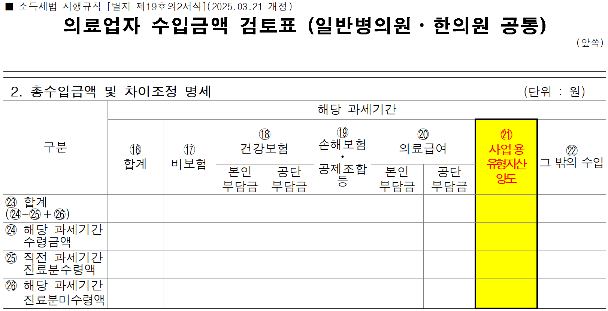
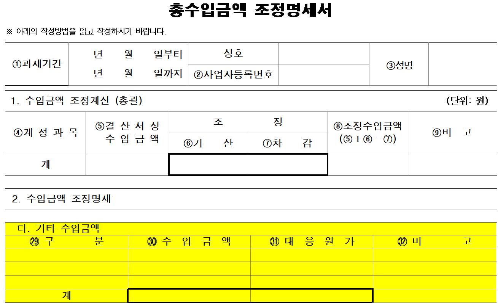

<callout icon="ℹ️" color="gray_bg">
본 글은 세무법인 지율 손창용 세무사가 작성한 **참고용 일반정보**입니다. 실제 의사결정 시에는 반드시 관련 세법·국세청 해석 등 공식 자료를 추가로 확인하시기 바라며, 본 글만을 근거로 한 조치에 대해 작성자 및 세무법인은 책임지지 않습니다.
</callout>
# 📌 결론부터 말씀드리면

<table header-row="true">
<tr><td>구분</td><td>업무용승용차 매각가액</td><td>기타 사업용 유형자산 매각가액</td></tr>
<tr><td>**복식부기의무자**</td><td>**총수입금액 산입**</td><td>**총수입금액 산입**</td></tr>
<tr><td>**간편장부대상자**</td><td>총수입금액 제외</td><td>총수입금액 제외</td></tr>
</table>

<table header-row="true">
<tr><td>핵심 포인트</td><td>내용</td><td>근거</td></tr>
<tr><td>과세 대상</td><td>**복식부기의무자**가 차량·운반구 등 사업용 유형자산을 양도하여 생긴 소득은 사업소득 (양도소득 대상인 부동산 등은 제외)</td><td>소득세법 제19조 제1항 제20호</td></tr>
<tr><td>건설기계</td><td>**2018.1.1. 이후 취득분**만 해당</td><td>소득세법 시행령 제37조의2</td></tr>
<tr><td>의료업 등 주의</td><td>사업장현황신고 시 유형자산 양도가액을 누락하면 과세관청이 **수입금액의 0.5% 가산세**를 부과하는 사례가 있음</td><td>소득세법 제78조, 제81조의3</td></tr>
<tr><td>세무조정</td><td>**1차**(기장의무 무관) 처분손익 제거 → **2차**(복식부기의무자만) 처분가액 산입·장부가액 필요경비 산입</td><td>총수입금액조정명세서 작성요령</td></tr>
</table>

# 💬 이런 질문을 많이 받습니다

<callout icon="" color="gray_bg">
"개인사업자인데 사업에 쓰던 차량(또는 의료장비)을 팔았습니다. 판 돈도 매출처럼 신고해야 하나요?"
</callout>

개인사업자의 사업소득은 원래 **소득원천설**(계속·반복적인 사업활동에서 생긴 소득만 과세하는 입장)에 따라, 자산을 한 번 처분해서 생긴 일시적 이익은 과세하지 않는 것이 원칙이었습니다. 그런데 **복식부기의무자**에 한해 사업용 유형자산 양도소득을 사업소득에 포함하도록 바뀌면서, 기장의무에 따라 처리가 달라졌습니다. 기업회계기준에 따른 장부 처리와 소득세법의 차이를 중심으로 정리해 보겠습니다.

# 📖 관련 세법은 이렇게 규정합니다

<table header-row="true">
<tr><td>조문</td><td>내용</td></tr>
<tr><td>소득세법 제19조 제1항 제20호</td><td>제160조 제3항에 따른 **복식부기의무자**가 차량 및 운반구 등 대통령령으로 정하는 사업용 유형자산을 양도함으로써 발생하는 소득. 다만, 제94조 제1항 제1호에 따른 양도소득(토지·건물)에 해당하는 경우는 제외</td></tr>
<tr><td>소득세법 시행령 제37조의2</td><td>사업용 유형자산 = 시행령 제62조 제2항 제1호에 따른 유형자산. 다만 「건설기계관리법 시행령」 별표 1의 건설기계는 **2018.1.1. 이후 취득**한 경우로 한정</td></tr>
<tr><td>소득세법 제33조의2 제3항</td><td>복식부기의무자의 업무용승용차 처분손실 중 차량별 **800만원 초과분**은 이월하여 필요경비 산입</td></tr>
<tr><td>소득세법 제78조</td><td>사업자는 다음 연도 **2월 10일까지** 사업장 현황신고(업종별 수입금액 명세 포함)</td></tr>
<tr><td>소득세법 제81조의3</td><td>대통령령으로 정하는 사업자가 사업장 현황신고를 하지 않거나 미달 신고하면 미달 **수입금액의 1천분의 5** 가산세 (산출세액이 없어도 적용)</td></tr>
<tr><td>소득세법 시행령 제83조 제8항</td><td>기업업무추진비(구 접대비) 한도 계산 시 수입금액 = **기업회계기준에 따라 계산한 매출액**</td></tr>
</table>

# 🔍 쟁점별로 살펴보겠습니다

## 1️⃣ 총수입금액 포함 범위

<table header-row="true">
<tr><td>구분</td><td>내용</td></tr>
<tr><td>업무용승용차</td><td>매각가액을 총수입금액에 산입하면, 매각 당시 **장부가액**(세무상 감가상각비 및 업무사용금액에 해당하지 않아 손금 부인된 금액이 있으면 이를 차감한 금액)을 필요경비에 산입</td></tr>
<tr><td>제외 자산</td><td>부동산(토지·건물) 매각은 양도소득세 대상이므로 사업소득에서 제외</td></tr>
<tr><td>건설기계</td><td>2018.1.1. 이후 취득분만 사업소득 대상</td></tr>
</table>

## 2️⃣ 의료업 등 사업장현황신고 불성실가산세 — 실무상 주의

<table header-row="true">
<tr><td>구분</td><td>내용</td></tr>
<tr><td>대상 업종</td><td>의료업, 수의업, 약국 개설 사업자 등 (복식부기의무자)</td></tr>
<tr><td>과세관청 해석</td><td>의료업자 수입금액 검토표(소득세법 시행규칙 별지 제19호의2호 서식)의 '2. 총수입금액 및 차이조정 명세'에 **'사업용유형자산양도'** 칸이 있으므로, 양도가액을 사업장현황신고(다음 연도 2월 10일까지)에서 누락하면 **0.5% 가산세** 적용대상이라고 봄</td></tr>
<tr><td>실무 대응</td><td>**사업장현황신고 시 유형자산 양도가액을 포함하여 신고**하는 것이 안전</td></tr>
</table>

<callout icon="✍️" color="blue_bg">
**필자 의견** — 사업용 유형자산 양도가액 누락에 가산세를 매기는 것은 다음 점에서 문제가 있다고 봅니다. 다만 세무서 등 과세관청이 실제로 가산세를 부과하는 경우가 있으므로 주의가 필요합니다.
- 소득세법 제19조는 사업용 유형자산 **양도로 발생하는 '소득'**을 규정할 뿐, 총수입금액의 개념과는 다릅니다.
- 소득세법 제24조의 총수입금액 계산규정에는 관련 내용이 없습니다.
- 제81조의3은 **'수입금액'**으로 규정하고 있는데, 소득세법에는 수입금액의 별도 개념이 없고 총수입금액만 있으므로 이를 그대로 적용하는 것은 무리입니다.
- 기업업무추진비 한도 계산 시 수입금액을 **기업회계기준에 따른 매출액**으로 규정(시행령 제83조 제8항)한 점을 고려하면, 사업장현황신고 불성실가산세의 수입금액도 기업회계에 따른 매출액으로 보는 것이 타당합니다.
</callout>

## 3️⃣ 유형자산 처분손익의 세무조정 방법

사업용 자산을 양도하면 장부에는 기업회계기준에 따라 처분손익을 인식합니다.

### 처분이익이 발생한 경우 (예시)

<table header-row="true">
<tr><td>차변</td><td>금액</td><td>대변</td><td>금액</td></tr>
<tr><td>보통예금 등</td><td>6,000</td><td>유형자산</td><td>10,000</td></tr>
<tr><td>감가상각누계액</td><td>9,000</td><td>**유형자산처분이익**</td><td>**5,000**</td></tr>
</table>

### 처분손실이 발생한 경우 (예시)

<table header-row="true">
<tr><td>차변</td><td>금액</td><td>대변</td><td>금액</td></tr>
<tr><td>보통예금 등</td><td>6,000</td><td>유형자산</td><td>15,000</td></tr>
<tr><td>감가상각누계액</td><td>6,000</td><td></td><td></td></tr>
<tr><td>**유형자산처분손실**</td><td>**3,000**</td><td></td><td></td></tr>
</table>

### 1차 세무조정 — 기장의무(복식·간편)와 상관없이

<table header-row="true">
<tr><td>구분</td><td>세무조정</td></tr>
<tr><td>처분이익</td><td>**총수입금액불산입** 처분이익 (인출)</td></tr>
<tr><td>처분손실</td><td>**필요경비불산입** 처분손실 (인출)</td></tr>
</table>

### 2차 세무조정 — 기장의무에 따라 추가로

<table header-row="true">
<tr><td>구분</td><td>세무조정</td></tr>
<tr><td>복식부기의무자</td><td>처분가액: **총수입금액산입** 처분가액 (인출) 장부가액: **필요경비산입** 장부가액 (인출)</td></tr>
<tr><td>간편장부대상자</td><td>세무조정 없음</td></tr>
</table>

## 4️⃣ 1차·2차로 나누어 조정하는 이유

<table header-row="true">
<tr><td>이유</td><td>설명</td></tr>
<tr><td>소득원천설</td><td>일시·우발적으로 발생한 소득은 과세소득에서 제외한다는 원칙에 따라 먼저 처분손익을 모두 제거</td></tr>
<tr><td>혼란 방지</td><td>손익계산서의 처분손익에 대한 조정을 기장의무별로 달리 하면 생길 수 있는 혼란을 막을 수 있음</td></tr>
<tr><td>서식 작성요령</td><td>복식부기의무자가 소득세법 제19조 제1항 제20호에 따라 한 번 더 조정하는 것은 **총수입금액조정명세서 작성요령**의 설명에 따른 것</td></tr>
</table>

[작성방법]

1. 수입금액 조정명세

가. 작업진행률에 의한 수입금액계산은 「소득세법 시행령」 제48조제5호 단서의 경우에 작성하며, ⑪도급금액란은 총도급금액을 기재하고, ⑬건설 등의 필요경비총예정액란은 해당 과세기간종료일 현재 기업회계기준서 제12호(건설업회계기준)를 적용 또는 준용하여 추정한 원가를 기재합니다.

나. 장기할부 판매자산에 대한 수입금액은 「소득세법 시행령」 제48조제4호에 따른 상품 등인 경우에 작성하는 것입니다.

**다. 기타 수입금액은 상기 “가.” 및 “나.” 외의 영업수익으로서 조정계산이 필요한 경우와 기타 수입금액이 누락된 경우에 작성하며, 구분란에는 위탁판매, 임대료수입, 유형자산 양도 등을 기재합니다. 유형자산 양도의 경우 부동산 이외의 사업용 유형자산을 양도한 복식부기의무자만 기재하며, 양도가액을 수입금액란에, 장부가액을 대응원가란에 각각 기재합니다.**

# ✅ 정리 및 실무 포인트

- [ ] 사업자가 **복식부기의무자**인지 먼저 확인 (간편장부대상자는 양도가액이 총수입금액에서 제외)
- [ ] 양도 자산이 토지·건물이면 양도소득세 대상 — 사업소득에서 제외
- [ ] 건설기계는 **2018.1.1. 이후 취득분**인지 확인
- [ ] 업무용승용차는 장부가액 계산 시 부인된 감가상각비 등을 반영하고, 처분손실 800만원 초과분 이월 규정 확인
- [ ] 의료업 등은 **사업장현황신고(2월 10일)에 유형자산 양도가액 포함** — 누락 시 0.5% 가산세 부과 사례 있음
- [ ] 세무조정은 1차(처분손익 제거) → 2차(복식부기의무자만 처분가액·장부가액 조정) 순서로

# ✍️ 맺음말

<callout icon="✍️" color="blue_bg">
사업용 자산 매각은 자주 있는 일이 아니라 신고 때 놓치기 쉽습니다. 특히 의료업 등 사업장현황신고 대상자는 2월 신고 단계부터 양도가액을 챙기시기 바랍니다.
</callout>

